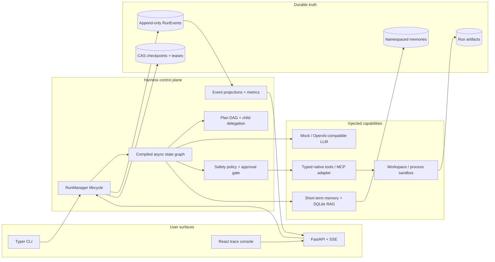

# Admire's AI Harness

[](https://github.com/LittleChenLiya/admires-ai-harness/actions/workflows/ci.yml)
[](https://github.com/LittleChenLiya/admires-ai-harness/actions/workflows/codeql.yml)
[](https://github.com/LittleChenLiya/admires-ai-harness/releases/latest)
[](https://github.com/LittleChenLiya/admires-ai-harness/labels/good%20first%20issue)
[](pyproject.toml)
[](LICENSE)

> A from-scratch, event-sourced and safe-by-default AI agent harness for learning how
> orchestration actually works—not a wrapper around LangGraph, CrewAI, or another agent
> framework.

Admire's AI Harness is a portfolio-scale reference implementation of the control plane
behind an AI agent system. It combines a typed asynchronous graph runtime, durable execution,
single- and multi-agent planning, model/tool/MCP ports, memory and local RAG, human approval,
evaluation, and a live React trace console. The complete offline path is deterministic, costs
`$0.00`, and requires no API key.

**Start here:** [Run it offline](#run-it) ·
[Explore the architecture](docs/architecture.md) ·
[Make a first contribution](docs/contributor-quickstart.md) ·
[Browse good first issues](https://github.com/LittleChenLiya/admires-ai-harness/labels/good%20first%20issue) ·
[Read the roadmap](ROADMAP.md)

## Why this project

- **Inspect the machinery:** graph scheduling, persistence, approvals, replay, evaluation, and
  multi-agent delegation are implemented here instead of hidden behind another agent framework.
- **Run before configuring:** every reference workflow and the benchmark run deterministically
  without a network, API key, or model bill.
- **Study failure semantics:** tests cover recovery conflicts, stale approvals, workspace escape,
  budget exhaustion, and other negative paths that toy agents often omit.
- **Extend through explicit ports:** model, tool, MCP, memory, storage, and observability boundaries
  are small enough to replace and review.

## Run it

### Docker: Web console and all three demos in one command

```bash
docker compose --profile demo up --build
```

This builds the React console and Python service, starts the harness at
<http://localhost:8000>, and runs the research, coding, and collaboration demos with the
offline mock model. The coding CLI demo uses an explicit local auto-approval flag; the Web
and API paths remain approval-first. Stop with `Ctrl+C`, then use
`docker compose down -v` if you also want to delete the demo data.

To start only the Web/API service:

```bash
docker compose up --build
```

### Local development

Requirements: Python 3.12+, [uv](https://docs.astral.sh/uv/), Node 22+, and pnpm 11.

```bash
uv sync --frozen --all-extras
pnpm --dir web install --frozen-lockfile
uv run admire demo all
uv run admire evaluate evaluation/reference.jsonl
```

For live development, run these in separate terminals:

```bash
uv run admire serve --reload
pnpm --dir web dev
```

Then open <http://localhost:5173>. API documentation is at
<http://localhost:8000/docs>.

## What the demos prove

| Workflow      | Agent shape                                     | Exercised capabilities                                                          | Expected offline result                   |
| ------------- | ----------------------------------------------- | ------------------------------------------------------------------------------- | ----------------------------------------- |
| Research      | researcher                                      | namespaced RAG, local hash embeddings, citations, model-token events            | grounded brief with three local sources   |
| Coding        | coder + reviewer                                | typed tools, workspace sandbox, risk policy, one-shot approval, artifact review | `slugify.py` in an isolated run workspace |
| Collaboration | planner + analyst + risk reviewer + synthesizer | validated plan DAG, parallel child runs, budget reservation, trace join         | reviewed rollout checklist                |

Example `uv run admire demo all --json` summary from the deterministic mock path:

```text
research       succeeded   2 steps   1 model call   0 tool calls   $0.0000
coding         succeeded   4 steps   1 model call   3 tool calls   $0.0000
collaboration  succeeded   5 steps   3 model calls  0 tool calls   $0.0000
```

The checked-in three-case benchmark currently produces `3/3` passing cases, `100%` pass
rate, and `$0.00` cost on the mock provider. Exact latency is machine-dependent.

## Architecture



The append-only event stream is the historical source of truth. A checkpoint is a restart
index at a node boundary, not a competing source of history. Events are persisted before
live publication, and public terminal status is not exposed until the terminal lifecycle
event exists. Checkpoint compare-and-swap and execution leases prevent two workers from
advancing the same run. Replay reads persisted state and events without invoking a model or
tool. See [the architecture guide](docs/architecture.md) for graph and recovery semantics.

## Capability matrix and evidence

| Capability                                                                              | Implementation                                                                                        | Executable evidence                                                                                  |
| --------------------------------------------------------------------------------------- | ----------------------------------------------------------------------------------------------------- | ---------------------------------------------------------------------------------------------------- |
| Async graph nodes, immutable state, conditional routing and compile-time validation     | [`runtime/graph.py`](src/admires_harness/runtime/graph.py)                                            | [`test_graph.py`](tests/unit/runtime/test_graph.py)                                                  |
| Event-sourced execution, streaming, budgets, repetition guard, checkpoint/resume/replay | [`runtime/engine.py`](src/admires_harness/runtime/engine.py)                                          | [`test_engine.py`](tests/unit/runtime/test_engine.py)                                                |
| Durable SQLite event/checkpoint stores with CAS revisions                               | [`storage/sqlite.py`](src/admires_harness/storage/sqlite.py)                                          | [`test_sqlite.py`](tests/unit/storage/test_sqlite.py)                                                |
| Validated plan DAG and parallel multi-agent delegation                                  | [`runtime/planning.py`](src/admires_harness/runtime/planning.py)                                      | [`test_planning.py`](tests/unit/runtime/test_planning.py)                                            |
| Mock and OpenAI-compatible complete/stream model adapters                               | [`adapters/models.py`](src/admires_harness/adapters/models.py)                                        | [`test_model_adapters.py`](tests/unit/test_model_adapters.py)                                        |
| Optional MCP stdio adapter, namespacing, allowlisting and normalized failures           | [`adapters/mcp.py`](src/admires_harness/adapters/mcp.py)                                              | [`test_mcp_adapter.py`](tests/unit/test_mcp_adapter.py)                                              |
| Typed tool schemas, output bounds and process-local idempotency receipts                | [`tools/registry.py`](src/admires_harness/tools/registry.py)                                          | [`test_registry.py`](tests/unit/tools/test_registry.py)                                              |
| External safety policy and run/tool/arguments/revision/expiry-bound approval            | [`safety/`](src/admires_harness/safety)                                                               | [`test_safety.py`](tests/unit/test_safety.py)                                                        |
| Traversal, symlink, junction and hard-link-resistant workspace boundary                 | [`safety/workspace.py`](src/admires_harness/safety/workspace.py)                                      | [`test_workspace_sandbox.py`](tests/security/test_workspace_sandbox.py)                              |
| Allowlisted process runner with time/output limits                                      | [`safety/process.py`](src/admires_harness/safety/process.py)                                          | [`test_process_sandbox.py`](tests/security/test_process_sandbox.py)                                  |
| Short-term memory, namespaced SQLite long-term memory and offline RAG                   | [`memory/`](src/admires_harness/memory)                                                               | [`test_memory.py`](tests/unit/test_memory.py)                                                        |
| Event-derived traces, status and token/cost metrics                                     | [`observability/projections.py`](src/admires_harness/observability/projections.py)                    | [`test_projections.py`](tests/unit/observability/test_projections.py)                                |
| Versioned JSONL datasets, deterministic scorers and baseline comparison                 | [`evaluation/`](src/admires_harness/evaluation)                                                       | [`test_evaluation.py`](tests/unit/test_evaluation.py)                                                |
| CLI, REST, SSE, approval/replay/cancel API and React console                            | [`cli.py`](src/admires_harness/cli.py), [`api/app.py`](src/admires_harness/api/app.py), [`web/`](web) | [`test_api_workflows.py`](tests/integration/test_api_workflows.py), [`web/tests/e2e`](web/tests/e2e) |

## Safety and crash semantics

The deterministic policy is outside the prompt and model. The default provider is offline,
network/process capabilities are disabled, unknown tools fail closed, and writes require a
human decision. An approval is bound to the run, exact tool and arguments digest, checkpoint
revision, and expiry; it is consumed once immediately before execution. Resolved but
unconsumed decisions remain recoverable after restart, while stale, opposite, or replayed
decisions are rejected.

There is deliberately no universal “exactly once” claim. If a process dies after approval
consumption but before a durable tool result exists, the harness will not blindly repeat the
side effect. A production side-effecting tool must provide durable idempotency or require
operator reconciliation; the built-in registry's receipt cache is process-local. The local
filesystem/process controls are defense in depth, not a hardened multi-tenant isolation
boundary. Read the full [security model](docs/security.md).

## Use a real model

Copy `.env.example` to `.env`, then set an OpenAI-compatible endpoint:

```dotenv
ADMIRE_MODEL_PROVIDER=openai-compatible
ADMIRE_MODEL_BASE_URL=https://api.openai.com/v1
ADMIRE_MODEL_NAME=gpt-4.1-mini
ADMIRE_MODEL_API_KEY=replace-me
```

The adapter supports structured non-streaming completion and SSE streaming. Provider
credentials are required only for this opt-in path. The reference prompts are deterministic
examples, not a guarantee that every compatible model produces identical output.

## Connect MCP deliberately

Install the optional transport with `uv sync --extra mcp`. Use
`stdio_mcp_executor(...)` to start a pinned server, provide an `allow_tools` set, create
matching `ToolSafetySpec` records, and wrap the returned executor in `SecuredToolExecutor`
before injecting it into a graph. MCP is not auto-wired into the three demos: a server is
untrusted code, and the adapter alone is not an authorization boundary. The exact extension
steps are in [docs/extending.md](docs/extending.md).

## Quality gates

The required GitHub Actions matrix runs:

- Ruff formatting/lint and strict mypy;
- the full pytest unit/integration/security suite;
- a separate branch-coverage gate for `admires_harness.runtime` (currently **88.42%**,
  required **85%**);
- deterministic three-demo smoke and evaluation report generation;
- Prettier, ESLint, TypeScript, Vitest and the production Web build;
- Playwright Chromium tests for research and coding approval workflows;
- the README's Docker Compose topology, including service health and all three offline demos;
- CodeQL for Python and JavaScript/TypeScript.

Run the same local gates with `make check`, or see the individual commands in
[`Makefile`](Makefile) and [`.github/workflows/ci.yml`](.github/workflows/ci.yml).

## What I learned by building it

- Agent reliability comes from explicit state transitions, durable boundaries, and recovery
  contracts—not from a larger system prompt.
- Event sourcing unifies live streaming, replay, metrics, debugging and evaluation, but only
  when publication order and terminal visibility are treated as consistency problems.
- Human approval is a capability token with identity, arguments, state revision, expiry and
  consumption semantics; a Boolean in a UI is not enough.
- Multi-agent delegation needs atomic budget reservation and explicit failure propagation to
  avoid multiplying cost and side effects.
- A credible harness documents residual risk and tests negative paths, especially filesystem
  escape, concurrent resume and crash windows.

## Contributing

New contributors are welcome. The fastest path is:

1. Follow the [contributor quickstart](docs/contributor-quickstart.md).
2. Pick an unassigned
   [`good first issue`](https://github.com/LittleChenLiya/admires-ai-harness/labels/good%20first%20issue)
   or [`help wanted`](https://github.com/LittleChenLiya/admires-ai-harness/labels/help%20wanted) task.
3. Comment that you would like to work on it, then keep the pull request focused on that issue.

The [code map](docs/code-map.md) routes changes to the right module and test suite. Larger ideas
should start as a feature request and align with the [roadmap](ROADMAP.md). See
[`CONTRIBUTING.md`](CONTRIBUTING.md) for review and test expectations.

Have a question or an early idea? Start a
[Discussion](https://github.com/LittleChenLiya/admires-ai-harness/discussions). If this repository
helped you understand agent runtimes, starring it helps other learners discover the project.

## Scope

This v1.0 is a learning and portfolio harness for local, controlled experiments. It is not a
self-trained foundation model, production multi-tenant SaaS, mobile client, distributed
scheduler, or formally hardened OS sandbox. SQLite and the in-process broker keep the system
easy to run and inspect; production scale would require a transactional database/outbox,
external queue, worker ownership/heartbeats, durable tool receipts and stronger tenant
isolation.

## Documentation

- [Architecture and runtime semantics](docs/architecture.md)
- [Security model and residual risks](docs/security.md)
- [Evaluation methodology](docs/evaluation.md)
- [Extension guide](docs/extending.md)
- [Contributor quickstart](docs/contributor-quickstart.md)
- [Code map](docs/code-map.md)
- [Roadmap](ROADMAP.md) · [Changelog](CHANGELOG.md)
- [Contributing](CONTRIBUTING.md) · [Security policy](SECURITY.md) · [Code of conduct](CODE_OF_CONDUCT.md)

Licensed under the [MIT License](LICENSE).
