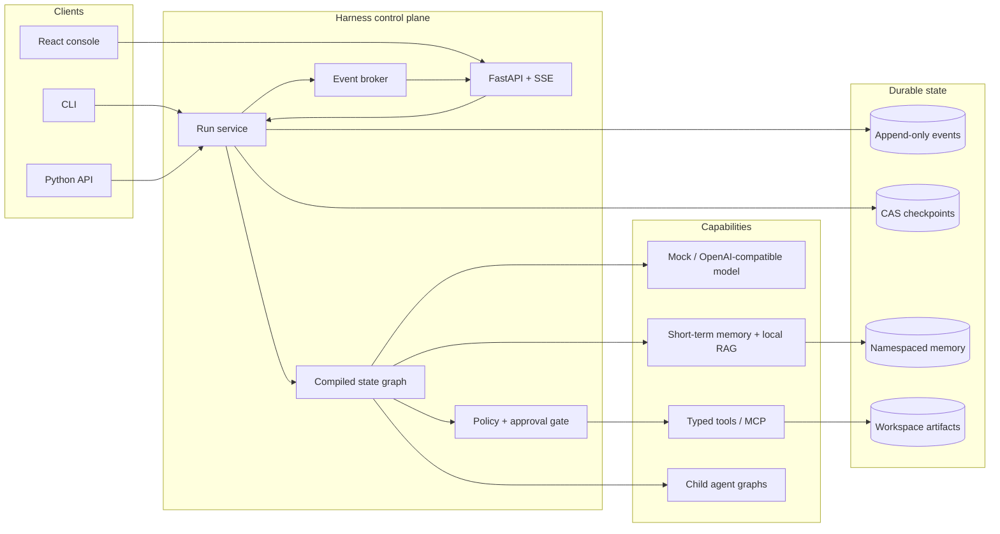

# Architecture

Admire's AI Harness is deliberately built without an agent orchestration framework. The
goal is to make the control plane inspectable: graph compilation, scheduling, state
reduction, persistence, policy checks, and evaluation all live in this repository.

## System map

## One execution language

Every client consumes the same versioned `RunEvent` envelope. The runtime appends events
before they are published live; a disconnected console can therefore reconnect using its
last sequence number. Observability is not an extra logging path—trace summaries and run
views are projections of the persisted event stream.

The append-only log is the historical source of truth. Checkpoints are restart indexes: they
capture state and the next node at a graph-node boundary. A compare-and-swap revision stops
two workers from advancing the same run simultaneously. Replaying a run is read-only and
never invokes a model or tool.

## Graph semantics

A `StateGraph` contains named asynchronous nodes and declared edges. `compile()` rejects an
unknown entry point, unknown edge target, duplicate fallback, and unreachable node before a
run starts. A node receives an immutable view of state and returns a `NodeResult`. In v1 the
runtime deep-copies the prior state, then applies the node update as a shallow top-level
overwrite. Conditional edges route against that new state. Applications that need nested
aggregation must compute it inside a node; pluggable reducers are outside the v1 contract.

Runs have explicit terminal states. Step, token, cost, repeated-action, and wall-clock budgets
are enforced by the runtime rather than delegated to a prompt. A child agent has its own run
ID and cancellation domain, shares the parent trace ID, and can only reserve a budget within
the parent's remaining budget. Its dependency/capability map is explicitly delegated by the
parent graph. Its failure is data that the parent must handle explicitly.

## Plan scheduling

'Plan' validates a planner-produced DAG before any work starts: step ids are unique, every
'depends_on' entry references a known step, self-dependencies are rejected, and
'topological_order()' must cover every step, which rejects cycles. The topological order is
stable — among simultaneously ready steps, author order is preserved.

'PlanExecutor' (used by 'execute_plan') schedules that DAG with explicit guarantees:

- Ready steps always launch in stable topological order, and at most 'max_concurrency' steps
  run at once. Slot accounting happens without an intervening 'await', so the concurrency
  limit cannot be raced.
- The parent budget is split up front into one identical per-step slice ('per_step_budget'),
  so the aggregate of all child budgets stays within the parent budget regardless of
  completion order. A parent budget too small for the plan is rejected before any delegation.
- Each step runs under 'step_timeout' (defaulting to its budget slice's timeout). A step that
  exceeds it is reported as 'timed_out' with the deadline in its reason.
- A step whose dependencies failed, timed out, or were cancelled never runs. It is marked
  'skipped' with a reason naming the failed dependency, and the skip propagates down the
  chain. Every step's final status and reason are returned in 'plan_step_statuses' and
  'plan_failures'.
- With 'fail_fast' (the default), the first failure cancels in-flight steps, marks unstarted
  steps, awaits every started task, and only then raises 'DelegationError'. External
  cancellation of the executor converges the same way: running steps are cancelled and
  awaited, pending steps are marked 'cancelled', and no task is left behind.
- 'on_step_event' receives a 'PlanStepEvent' for every lifecycle transition (sync or async
  callbacks). A raising callback is isolated and counted in 'callback_errors'; it never
  corrupts the schedule.

## Side effects and recovery

The harness does not claim universal exactly-once execution. A tool call is at-least-once
across process failure and carries a stable idempotency key. The built-in registry caches
receipts only in process; a production tool must durably store its own receipt if it needs
crash-safe deduplication. Read-only replay is always safe.

An approval is bound to the run, tool arguments digest, checkpoint revision, expiry, and a
single consumption. This prevents approval replay after state or arguments change.

## Dependency boundaries

The runtime depends only on small `Protocol` ports. SQLite, in-memory stores, model providers,
MCP, and FastAPI adapt to those ports. The deterministic mock provider is a first-class path,
not a test stub hidden behind the real service. That keeps every reference workflow and the
entire evaluation suite runnable without a network or paid credential.
