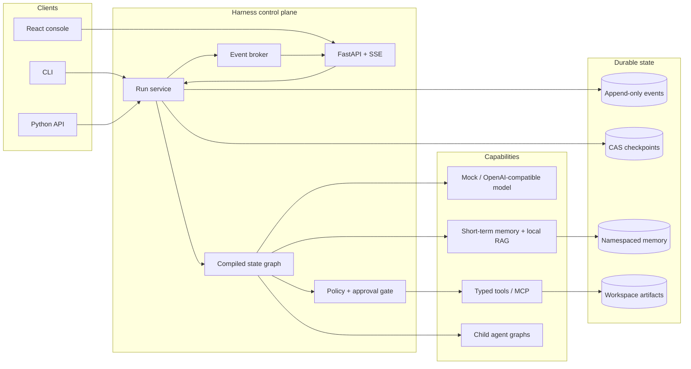

# Architecture

Admire's AI Harness is deliberately built without an agent orchestration framework. The
goal is to make the control plane inspectable: graph compilation, scheduling, state
reduction, persistence, policy checks, and evaluation all live in this repository.

## System map

## One execution language

Every client consumes the same versioned `RunEvent` envelope. The runtime appends events
before they are published live; a disconnected console can therefore reconnect using its
last sequence number. Observability is not an extra logging path—trace summaries and run
views are projections of the persisted event stream.

The append-only log is the historical source of truth. Checkpoints are restart indexes: they
capture state and the next node at a graph-node boundary. A compare-and-swap revision stops
two workers from advancing the same run simultaneously. Replaying a run is read-only and
never invokes a model or tool.

## Graph semantics

A `StateGraph` contains named asynchronous nodes and declared edges. `compile()` rejects an
unknown entry point, unknown edge target, duplicate fallback, and unreachable node before a
run starts. A node receives an immutable view of state and returns a `NodeResult`. In v1 the
runtime deep-copies the prior state, then applies the node update as a shallow top-level
overwrite. Conditional edges route against that new state. Applications that need nested
aggregation must compute it inside a node; pluggable reducers are outside the v1 contract.

Runs have explicit terminal states. Step, token, cost, repeated-action, and wall-clock budgets
are enforced by the runtime rather than delegated to a prompt. A child agent has its own run
ID and cancellation domain, shares the parent trace ID, and can only reserve a budget within
the parent's remaining budget. Its dependency/capability map is explicitly delegated by the
parent graph. Its failure is data that the parent must handle explicitly.

## Plan scheduling

`Plan` validates its step DAG at construction: unique ids, known dependencies, no
self-dependencies, and no cycles. `topological_order()` is stable: among the steps that are
ready at the same time, author order is preserved, so execution order is reproducible.

`execute_plan` runs the DAG with a dependency-aware scheduler instead of wave-based
batching. At most `max_concurrency` child runs are in flight at any moment, and a ready
step starts as soon as a dependency completes and a slot frees up. Each step runs under an
evenly divided share of the parent budget plus an optional `step_timeout_seconds` cap;
the runtime reserves child budgets atomically, so concurrent steps cannot overspend the
parent. A step that fails, times out, or exceeds its budget is recorded in
`plan_failures` with the reason. A step whose dependency failed or was skipped never
runs and is recorded in `plan_skipped` with a traceable cause (for example
`dependency 'research' failed`). With `fail_fast=True` the first failure cancels every
in-flight step, marks the rest as skipped, and raises `DelegationError`; external
cancellation likewise cancels and awaits every started step before propagating, so no
asyncio task is left pending. Progress is reported through `log` events carrying a
`plan_event` payload (`plan_started`, `plan_step_started`, `plan_step_completed`,
`plan_step_failed`, `plan_step_skipped`, `plan_completed`); a failing event callback
never aborts scheduling and is counted in the result metadata.

## Side effects and recovery

The harness does not claim universal exactly-once execution. A tool call is at-least-once
across process failure and carries a stable idempotency key. The built-in registry caches
receipts only in process; a production tool must durably store its own receipt if it needs
crash-safe deduplication. Read-only replay is always safe.

An approval is bound to the run, tool arguments digest, checkpoint revision, expiry, and a
single consumption. This prevents approval replay after state or arguments change.

## Dependency boundaries

The runtime depends only on small `Protocol` ports. SQLite, in-memory stores, model providers,
MCP, and FastAPI adapt to those ports. The deterministic mock provider is a first-class path,
not a test stub hidden behind the real service. That keeps every reference workflow and the
entire evaluation suite runnable without a network or paid credential.
